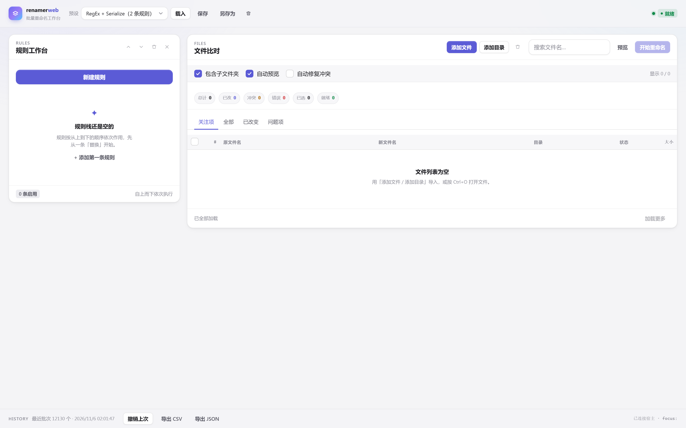
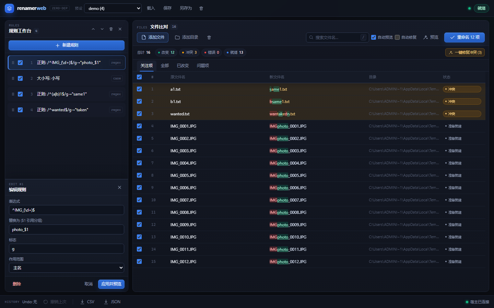

# renamer-web

[](https://github.com/all-whole-whole/renamer-web/actions/workflows/ci.yml)
[](LICENSE)
[](https://nodejs.org)
[](package.json)
[](#已知限制)

按 `ReNamer 7.3` 的能力面重构的批量重命名工具：**零运行时依赖**的 Node 宿主 +
**系统默认浏览器**里的 React 工作台。不打包 Electron / Tauri / Chromium；
界面用 React 19 + Vite（devDependencies），构建产物随仓库提供，运行时仍然只需要 Node。



左栏规则、右栏文件；规则编辑器就地展开，不再用抽屉遮住右侧比对表。



## 快速开始

```bat
双击 start.cmd
```

`start.cmd` 会短暂保留一个控制台窗口（等 `/api/ping` 与浏览器连接通常 1–6 秒）；这是
cmd 宿主本身，不是 Node 宿主——Node 由 `launch-server.ps1` 以隐藏窗口拉起。按用户决定
不再引入 VBS 或自编译 `start.exe`：黑窗可以接受，不可解释的二进制会带来 SmartScreen、
杀软误报和额外排障成本。

双击后发生什么：

| 情况 | 表现 |
|---|---|
| 首次启动 | 后台起 Node 宿主（隐藏窗口）；启动器自身是 cmd 窗口，1–6 秒后随 `exit /b` 关闭 |
| 已经开着 | 不重复起进程，直接把已打开的 `renamer-web` 窗口切到前台（约 1.3 秒） |
| 端口被别的程序占 | 提示改 `config.json` 的 `port`，然后暂停等你按键 |
| 没装 Node | 提示去 nodejs.org，然后暂停等你按键 |

启动失败时日志在 `.tmp\logs\server.err.log`。三个启动脚本都是**纯 ASCII**（`cmd.exe` 用 OEM 代码页解析 `.cmd`，中文提示只会变成乱码，因此界面文案一律放在页面里）。

手动方式：

```powershell
node bin\check.mjs          # 环境体检
node server\index.mjs       # 前台启动（CTRL+C 退出）
```

浏览器打开 <http://127.0.0.1:8758/>。关掉标签页后宿主会在空闲 120 秒后自行退出。

## 前端构建

界面源码在 `web/src/`（React 19 + Vite），组件基座内联在 `web/ui/`（见
[web/ui/README.md](web/ui/README.md)）；`public/` 是构建产物，`public/diff.mjs` 由
`web/public/` 原样复制，测试仍直接 import 它。

```powershell
npm ci               # 只装 devDependencies（React / Vite / TypeScript）
npm run web:check    # tsc 类型检查
npm run web:dev      # 5395，/api 代理到 8758
npm run web:build    # Vite 构建，产物写入 public/
```

`dependencies` 仍为空、`node_modules` 不进版本库，CI 的「零运行时依赖」门禁不受影响：
**运行**这个工具不需要任何 `npm install`，只有当你要改界面时才需要上面四条命令。
旧的原生实现留在 `web/legacy/`，回滚时把三个文件拷回 `public/` 再跑一次构建即可。

## 界面与快捷键

- **双栏工作台**：左侧 360px 规则栈（拖拽排序、启停、内联编辑），右侧文件比对网格。
- **目录导入**：原生文件夹选择支持 `Ctrl` 多选；递归扫描三级及以上子目录，并跟随
  junction / 符号链接（带循环保护）。导入后自动切到「全部」视图，未变化文件也能看到和勾选。
- **元标签 (Meta Tags)**：替换、正则替换、插入、移除、重排和 UserInput 模板的文本字段
  旁有「🏷 插入元标签」按钮，可插入 `[:Date_Now:]`、`[:File_FolderName:]`、
  `[:File_Size:]`、`[:File_DateModified:]` 等标签；插入的是标签本身，预览时按文件实时展开。
  完整目录包括 `Date_Now`、`File_Size*`、`File_DateCreated/Modified`、`File_Path`、
  `File_Directory`、`File_Name`、`File_BaseName`、`File_Extension`、`File_FolderName`。
- **字符级 Diff**：新文件名用 `<del>` / `<ins>` 标出删除与新增片段，不靠整行变色猜改动。
- **冲突闭环**：冲突行注入警告底色，状态 Tooltip 说明 `目标已存在：xxx`；`一键修复冲突`
  自动追加 `_1.._n`，同时避开磁盘和批次内已占用的名称。
- **虚拟滚动**：10,000 行只在 DOM 里保留 27~36 个行节点，表头与行共用同一个滚动容器，
  没有滚动条宽度错位。

| 快捷键 | 行为 |
|---|---|
| `Ctrl + N` | 新建规则（聚焦内联编辑器） |
| `Ctrl + O` | 添加文件 |
| `Ctrl + Enter` | 执行重命名（仍会二次确认） |
| `Ctrl + Z` | 撤销上一批次（焦点不在输入框时） |
| `Space` | 表格行获得焦点时切换选中 |
| `F5` / `Ctrl + R` | 不刷新页面，强制刷新列表与预览 |
| `/` | 聚焦搜索框 |
| `Esc` | 关闭内联编辑器 / 清空搜索 |

## 设计要点

| 维度 | 选择 |
|---|---|
| 运行时 | Node.js ≥ 20，仅用 `node:http` / `node:fs` / `node:path` / `node:vm` / `node:child_process` |
| 前端 | 原生 ES Module + CSS 变量，无构建步骤；左侧规则 / 右侧文件双工作台 |
| 浏览器 | ShellExecute 拉起默认浏览器普通标签页，不复用独立 Profile |
| 数据 | 条目常驻宿主内存；前端按窗口（`offset/limit`）取行，DOM 只保留可视区 |
| 并发 | `AbortController` 中止旧的文件窗口/预览请求，并用服务端 `revision` 丢弃过期回执 |
| 比对 | 前端内置 LCS 微算法（`public/diff.mjs`），字符级 `<del>` / `<ins>` 高亮 |
| 落盘 | 两阶段 rename（临时名 → 目标名），支持大小写改名、A↔B 互换、失败回滚 |
| Windows 锁 | `EPERM` / `EBUSY` 首次失败后 3 次 × 50ms 重试，避免预览窗格/杀软短暂占用 |
| 撤销 | 每次批次写 `undo/<batchId>.json`，可整体反向恢复；按 50 条 / 30 天回收 |
| 冲突 | 目录名集合 + 批次占用表，自动递增无 500 条硬上限 |
| 本地安全 | Host 与 Origin 解析后精确匹配，拒绝 `127.0.0.1:8758.evil.test` 之类的子串绕过 |

## 目录

```
renamer-web/
├─ bin/            check.mjs（体检） / cli.mjs（无头执行）
├─ docs/           经验沉淀.md / ui.png / ui-inspector.png
├─ public/         构建产物：index.html + assets/ + diff.mjs（测试直接 import）
├─ web/            React 源码（src/）、内联组件基座（ui/）、vite 配置、public/diff.mjs
├─ web/legacy/     旧原生实现（app.js / styles.css / index.html / verify-ui.mjs）
├─ scripts/        launch-server.ps1 / open-app.ps1 / react-e2e.mjs / verify-scale.mjs
├─ server/
│  ├─ index.mjs    HTTP + SSE 网关、空闲生命周期
│  ├─ http-guard.mjs  Host / Origin 精确校验
│  ├─ picker.mjs   原生对话框（文件夹多选 / DPI-V2 + 隐形 owner）
│  ├─ metatags.mjs 元标签目录与按文件展开
│  ├─ presets.mjs  .rnp 预设读写
│  └─ renamer/     engine / conflicts / scanner / filter / transaction / metadata
│     └─ rules/    18 条规则，一条一个文件
├─ test/run.mjs    55 项断言（规则、Diff、冲突、事务、HTTP、10k 吞吐）
├─ config.json     端口 / 空闲超时
└─ start.cmd
```

## 规则集（18）

`replace` `regex` `insert` `delete` `remove` `case` `strip` `cleanup` `padding`
`serialize` `translit` `rearrange` `extension` `script` `reformatdate` `list`
`randomize` `userinput`

每条规则对应 ReNamer 的一个 `TRule*` 类；参数 schema 由 `server/renamer/rules/index.mjs`
统一导出，前端内联编辑器直接按 schema 渲染，避免两边漂移。每条元数据同时携带
`label`（英文 (中文)）、`summary`、`help`、`examples` 和逐字段 `hint`：编辑器顶部显示
可折叠的帮助卡，字段下方显示提示；点击案例会填充表单并即时预览草稿（不会写入规则栈，
关闭编辑器自动恢复已提交预览）。

`reformatdate` 支持从文件名、mtime/ctime 或 EXIF 取日期，自动识别 `20260320`、
`2026-03-20`、`20.03.2026` 等布局；`list` 支持 `key -> value`、`=`、`|`、Tab 映射与
按行顺序替换；`randomize` 使用 `node:crypto`；`userinput` 支持
`[:name:]` / `[:ext:]` / `[:folder:]` / `[:size:]` / `[:index:]` 占位符。

`script` 用 `node:vm` 隔离执行，暴露 `FileName`（读写）/ `FilePath` / `FileExt` / `Index` / `Meta`，
单文件硬超时 100ms，死循环会变成该行的错误状态而不是拖死宿主。

## API

| 方法 | 路径 | 说明 |
|---|---|---|
| GET | `/api/ping` | 身份嗅探（pid / clients / items） |
| GET | `/api/rule-types` | 规则 schema 与元标签目录（`types` / `metaTags`） |
| GET | `/api/pick?kind=files\|folders\|save` | 原生对话框 |
| POST | `/api/scan` | 递归扫描，`{paths, options, mode:'replace'\|'append'}` |
| POST | `/api/preview` | 规则栈求值；`transient:true` 预览未应用草稿且不写入规则栈 |
| GET | `/api/files?offset&limit&view` | 游标分页；`view=focus\|all\|changed\|issues` |
| POST | `/api/rename` | 执行两阶段重命名 |
| POST | `/api/undo` | 撤销指定批次（缺省最近一次） |
| GET/POST | `/api/presets` | 预设列表 / 保存 / 载入 / 删除 |
| GET | `/api/export?format=csv\|json` | 导出预览结果 |
| GET | `/api/events` | SSE：扫描进度、重命名进度、错误 |

## 命令行

```powershell
node bin\cli.mjs --list-presets
node bin\cli.mjs --preset photos --dir "D:\Camera"          # 预览
node bin\cli.mjs --preset photos --dir "D:\Camera" --yes    # 执行
node bin\cli.mjs --undo <batchId>
```

## 测试

```powershell
node test\run.mjs
```

覆盖：文件名拆分与双扩展名、18 条规则（含日期/列表/随机/模板）、LCS Diff 还原、非 Error 规则隔离、非法字符与保留
设备名、扩展名尾部点/空格、批次冲突与 600 同名自动修复、磁盘冲突、定长修复、两阶段落盘、
EPERM/EBUSY 重试、撤销回滚、大小写改名、A↔B 互换、撤销日志回收、掩码过滤、Host/Origin
精确校验、append 扫描后视图缓存失效、10k 项 500ms 性能预算。

UI 端到端（React 版）：`node scripts\react-e2e.mjs <目录绝对路径>`，需先起宿主与
`--remote-debugging-port=9335` 的浏览器；2026-11-08 实测 3 个文件 → Replace 规则 → 重命名 → 撤销恢复原名。

## 本机验收数据（Edge 156 / Node 24 / 1440×900）

| 指标 | 结果 |
|---|---|
| 10,000 文件扫描 | 253 ms |
| 10,000 项 4 规则端到端预览（点击到 UI 就绪） | 105 ms |
| 27 行可见窗口 Diff 切片 | 0.138 ms |
| 10,000 行虚拟滚动节点数 | 27（顶部）/ 35（offset 5000）/ 36（滚动中） |
| 滚动帧间隔 | 均值 16.21 ms，P95 16.8 ms，60 帧 0 次 >25 ms |
| 横向溢出 | 0 px |

UI 验收脚本通过 CDP 驱动真实浏览器（不依赖 npm 包）：

```powershell
# 先用 --remote-debugging-port=9222 打开页面，并至少保存一个预设
node scripts\verify-ui.mjs --cdp http://127.0.0.1:9222
node scripts\verify-scale.mjs --cdp http://127.0.0.1:9222 --path "E:\path\to\10k"
```

## 已知限制

见 [docs/经验沉淀.md](docs/经验沉淀.md) 第 14 节。要点：CJK 拼音未内置、元数据仅 EXIF/ID3；
撤销日志已按 50 条 / 30 天自动回收，仍建议定期备份重要的重命名批次。

## 贡献

欢迎提 Issue / PR。流程与环境要求见 [CONTRIBUTING.md](CONTRIBUTING.md)：零依赖是硬约束，
提交前请确保 `node test\run.mjs` 的 55 项断言仍然全绿；涉及宿主生命周期、落盘或撤销的改动，
请在 PR 描述里附上复现步骤与实际输出。

## 许可证

[MIT](LICENSE) © 2026 hertui34

